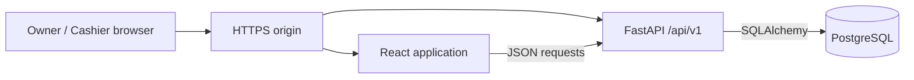

# Yab's Salon Management System

At my family's salon, handwritten sales logs and calculator-based commissions made busy days harder to reconcile. I began building Yab's Salon Management System to address that recurring problem while learning how to turn business requirements into a tested web application.

The browser-based system records completed sales, calculates Staff Commission and Business Share, and makes transaction history and reports available to the authorized Owner and Cashier. It is designed for one salon and deployed to cloud staging for synthetic testing.

## Screenshots

Approved, redacted staging screenshots are pending. Planned views: Cashier Sales, Transaction History, and Owner Reports. Real customer, payment, account, and financial information will not be shown.

## Project status

| Area | Current status |
| --- | --- |
| Core workflows | Implemented with automated backend and frontend tests; Owner and Cashier acceptance is still needed for production use |
| Cloud deployment | Render + Neon Free staging intended for synthetic testing; staging data contents have not been independently audited here; no approved live financial use |
| Durable sale recovery | `reserved_v1` implemented but default-disabled; activation requires a coordinated cutover |
| Operational recovery | Backup and restore procedures and a read-only checker exist; backup/PITR coverage, alerts, and restore drills are not verified |

Before production use, the team must validate hosting and secrets, Owner/Cashier workflows, the chosen proxy's client-IP behavior, encrypted off-site backups and continuous WAL/PITR coverage, failure alerts, an isolated restore drill, and the 24-hour RPO/RTO targets. The [staging runbook](docs/04-development/Free%20Cloud%20Staging%20Runbook.md), [deployment and activation runbook](docs/04-development/Deployment%20and%20Activation%20Runbook.md), and [backup and restore runbook](docs/04-development/Backup%20and%20Restore%20Runbook.md) describe the planned checks; they are not evidence of completed production verification.

## Implemented MVP workflows

| Area | Owner | Cashier |
| --- | --- | --- |
| Sales | Record Direct sales; enter verified paper sales for today or earlier dates | Record Direct sales; enter verified paper sales for today |
| History | View current and historical transactions; void a completed transaction with a reason | View transactions for the current Asia/Manila business date |
| Reports | View daily and monthly financial summaries, including staff performance | View today's daily financial summary |
| Configuration | Manage staff, services, products, prices, and commission rules | No configuration access |
| Recovery | Investigate sale attempts and perform Owner-only reconciliation or cancellation where enabled | Investigate their own pending sale status; escalate unresolved attempts |

Sales support multiple services and products, Cash or GCash payment, per-item staff attribution, and server-calculated Staff Commission and Business Share. Transaction items retain selling-price and commission snapshots. Voided transactions remain in History but are excluded from active report totals. Manual back-entry requires a paper reference and attestation that historical values were checked against retained evidence; the attestation is not independent proof.

Owner and Cashier access is enforced by the API. Login uses server-managed sessions and role checks; state-changing requests retain Origin and CSRF protection. Business Share is the portion after Staff Commission, not net profit.

Sale submission uses idempotency keys and pending-sale recovery safeguards. The database-backed `reserved_v1` sale-attempt protocol, including durable cancellation fences, is implemented behind a server-side feature gate. The gate defaults to **off**; activating it requires a coordinated migration and worker cutover. A daily transaction number is a display label that can change after a backdated entry. The permanent database transaction ID remains the identifier for API operations and audit references.

## Technology and architecture

| Layer | Technology | Purpose |
| --- | --- | --- |
| Frontend | React, Vite, CSS | Responsive Owner and Cashier workspaces |
| API | Python, FastAPI, Pydantic | Authentication, authorization, validation, and financial rules |
| Persistence | PostgreSQL, SQLAlchemy 2.x, Alembic | Relational records, transactions, constraints, and versioned schema changes |
| Testing | pytest, Vitest, React Testing Library | Backend rules, API behavior, and frontend workflows |
| Staging | Docker, Render Free, Neon Free | One HTTPS origin serving the React build and FastAPI with an isolated staging database |

The application is a modular monolith. In staging, FastAPI serves the built React app and its `/api/v1` endpoints on one HTTPS origin; the frontend never connects directly to PostgreSQL. Local development uses Vite's API proxy.

FastAPI enforces permissions and Manila business-date rules and calculates financial values. [System Architecture](docs/03-design/System%20Architecture.md) and [Database Design](docs/03-design/Database%20Design.md) provide more detail.

## How the project was built

Development has taken approximately five months and has followed a documentation-driven sequence: observe the salon workflow, define the MVP and user stories, design the data and permissions, implement small slices, test, and revise from Owner and Cashier feedback. The [Business Requirements Specification](docs/01-discovery/Business%20Requirements%20Specification.md), [User Personas](docs/01-discovery/User%20Personas.md), [MVP Scope](docs/02-planning/MVP%20Scope.md), [Product Requirements Document](docs/02-planning/Product%20Requirements%20Document.md), [User Stories](docs/02-planning/User%20Stories.md), and [Product Roadmap](docs/02-planning/Product%20Roadmap.md) record that process. Some planning documents predate later approved implementation decisions; current behavior should be checked against code and tests.

### AI-assisted development

I led the product work: observing the family salon's workflow, defining requirements, preparing documentation, making business decisions, and coordinating implementation, testing, and staging deployment. I used OpenAI Codex extensively to implement code, develop tests, and troubleshoot issues. Reviewing the results against the salon's requirements has been a hands-on learning experience in software engineering.

## Local development

Prerequisites: Python 3.11+, Node.js 20.19+ (20.x) or 22.12+ with npm (per the locked Vite version), and a local PostgreSQL database dedicated to development. Work from the repository root unless a command changes directory.

1. In `backend/`, create and activate a virtual environment, then install the project and test dependencies with `python -m pip install -e ".[dev]"`.
2. Copy `backend/.env.example` to the Git-ignored `backend/.env`. Set a local development database, `AUTH_COOKIE_MODE=localhost`, the exact Vite origin `http://127.0.0.1:5173`, and a stable random `AUTH_RATE_LIMIT_SECRET` of at least 32 bytes. Keep `SALE_ATTEMPT_PROTOCOL_ENABLED=0`. Never use staging or production credentials here.
3. Verify the connected **development** database before applying migrations. From `backend/`, run `alembic upgrade head` only against that intended local database. Start the API with `python -m uvicorn app.main:app --reload`.
4. From `frontend/`, run `npm ci` and `npm run dev`, then open `http://127.0.0.1:5173`.

See the [frontend development guide](frontend/README.md) for proxy and cookie details. Keep credentials in protected, Git-ignored configuration.

## Testing and verification

Run ordinary backend tests with `cd backend` followed by `python -m pytest`. Run frontend tests with `cd frontend` followed by `npm test`; use `npm run build` to verify the production bundle. Backend tests cover authentication and RBAC, sales and idempotency, financial calculations, History, reports, migrations, and recovery. Frontend tests cover the corresponding workspaces and interactions.

Some PostgreSQL integration and real-commit concurrency suites are guarded and require a separately verified, isolated test database plus explicit opt-in. The repository also includes a read-only [restore verification utility](deploy/backup/verify_restore.py). Ordinary tests and the utility alone do not establish production financial safety.

The current schema does not provide branch isolation. Inventory, appointments, customer profiles, payroll, and offline synchronization are outside this single-salon MVP.
